 

  

 

## `~/about`

  

 

I'm a third-year-style builder at heart: a **B.Tech CSE (Data Science)** student at **ABES Engineering College** who likes taking a product idea all the way from database schema to polished UI. I care about clean APIs, snappy real-time experiences, and adding **ML/AI** where it genuinely makes an app smarter.

<table align="center">
<tr>
<td align="center" width="25%"><h3>🧠 500+</h3>LeetCode problems</td>
<td align="center" width="25%"><h3>⭐ 1416</h3>CodeChef peak rating</td>
<td align="center" width="25%"><h3>🏆 40+</h3>live contests</td>
<td align="center" width="25%"><h3>🚀 3</h3>full-stack projects shipped</td>
</tr>
</table>

---

## `~/tech-stack`

 
 
 
 

<b>🔎 Click to expand the full skill breakdown</b>

 

| Area | What I work with |
| :-- | :-- |
| **Languages** | C++, JavaScript, JavaScript, TypeScript |
| **Frontend** | React, Redux Toolkit, Tailwind CSS, Vite |
| **Backend & APIs** | Node.js, Express, REST, JWT, Role-Based Access Control (RBAC) |
| **Databases** | PostgreSQL, MySQL, MongoDB, Redis, SQL |
| **Real-time & Messaging** | Socket.IO, Redis caching, RabbitMQ |
| **ML / AI** | Scikit-learn, OpenAI API |
| **Tools** | Git, GitHub, Prisma, Multer, ImageKit, Supabase Edge Functions |
| **CS Fundamentals** | DSA, DBMS, Operating Systems, OOP |

---

## `~/projects`

<table>
<tr>
<td width="50%" valign="top">

### 🎟️ Smart Queue Platform
`Aug – Sep 2026`

AI-powered **real-time queue and token management**. Two ML models (FastAPI + Scikit-learn) forecast waiting time and queue demand, and the backend serves them live.

- JWT auth + RBAC for multiple user roles
- Redis caching + Socket.IO for live token updates

    

[**View repository →**](https://github.com/pranav06082004/smart-queue-platform)

</td>
<td width="50%" valign="top">

### 📄 AI Resume Builder
`Feb – Mar 2026`

MERN resume builder with **OpenAI-generated** summaries and job descriptions tailored to the user's profile.

- Secure JWT + Bcrypt auth on all protected routes
- Photo/document uploads via Multer + ImageKit
- Redux Toolkit state and 5+ client-side routes

    

[**View repository →**](https://github.com/pranav06082004/Resume-builder)

</td>
</tr>
<tr>
<td colspan="2" valign="top">

### 🛡️ Authen-X · AI Misinformation Detection
`Dec 2025 – Jan 2026`

A full-stack platform that uses AI to **evaluate the credibility of text, URLs and multimedia**. Serverless analysis on **Supabase Edge Functions** returns instant verdicts, confidence scores and detailed insights, with a private dashboard, RBAC and per-user analysis history.

   

[**View repository →**](https://github.com/pranav06082004/Authen-X)

</td>
</tr>
</table>

---

## `~/stats`

 

 

<b>🧩 Competitive programming snapshot</b>

 

| Platform | Highlights |
| :-- | :-- |
| **[LeetCode](https://leetcode.com/u/pranav0608/)** | 500+ problems solved |
| **[CodeChef](https://www.codechef.com/users/pranav0608)** | Peak rating **1416** (2★) · 40+ live contests · best live finish under rank 1200 |
| **GeeksforGeeks** | 100+ problems · coding score 500+ |

---

## `~/currently`

| 🔭 Exploring | 🛠️ Building | 🎯 Aiming for |
| :--: | :--: | :--: |
| System design, message queues, ML in production | Scalable real-time backends | Internships & SDE roles |

<b>🎲 Click for a random dev fact about me</b>

 

I write C++ for contests and TypeScript for products, and I enjoy that the two worlds keep making each other better. ⚡

---

### 🐍 Contribution snake

 

